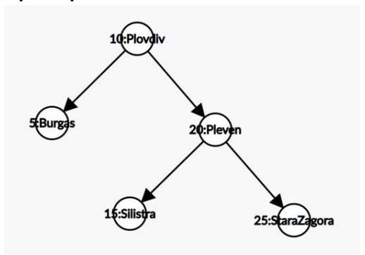

<div align="center">

# Седмица 8 — Двоично наредено дърво (BST)

**Двоично наредено дърво · Търсене, вмъкване и триене · Сериализация · Итератор**

[](https://en.cppreference.com/)
[](#)
[](#задачи)

</div>

### Как да компилирам примерите?

```bash
g++ -std=c++17 -Wall -Wextra implementation/BST/main.cpp -o bst && ./bst
```

---

# Задачи

### Задача 1. Валидиране на двоично наредено дърво

По подаден корен на двоично дърво определете дали дървото е двоично наредено дърво за търсене (binary search tree, BST).

Трябва да са изпълнени следните правила:

- Лявото поддърво съдържа само върхове със стойности, по-малки от корена.
- Дясното поддърво съдържа само върхове със стойности, по-големи от корена.
- Лявото и дясното поддърво също трябва да са валидни двоични наредени дървета за търсене.


```text
Input:  root = [2,1,3]               Output: true
Input:  root = [5,1,4,null,null,3,6] Output: false
```

Във втория пример стойността на корена е 5, но дясното му дете е 4.

### Задача 2. K-ти най-малък елемент в BST

По даден корен на двоично наредено дърво и цяло число `k` върнете `k`-тия най-малък елемент (броим от 1) от всички върхове на дървото.


```text
Input:  root = [3,1,4,null,2], k = 1         Output: 1
Input:  root = [5,3,6,2,4,null,null,1], k = 3    Output: 3
```

**Ограничения:**

- Броят на възлите е `n`.
- 1 <= k <= n <= 10<sup>4</sup>
- 0 <= Node.val <= 10<sup>4</sup>

### Задача 3. Сериализация и десериализация на BST

Сериализацията на структура от данни или обект представлява представянето му като поредица от битове (или символи), които да се пазят в буфер или да се предават по мрежата с цел предаване на друга програма и пресъздаване на съответната структура.

Нашата цел е да направим алгоритъм, който сериализира двоично наредено дърво, като го превърне в символен низ. Трябва също да можем да десериализираме дърво — по подадения низ да построим дървото обратно.

```text
Input:  root = [2,1,3]    Output: [2,1,3]
Input:  root = []         Output: []
```

**Ограничения:**

- Броят на възлите е в диапазона [0, 10<sup>4</sup>].
- 0 <= Node.val <= 10<sup>4</sup>
- Гарантирано е, че подаденото дърво е двоично наредено дърво.

### Задача 4. Сортиран списък към балансирано BST

По подадено начало на свързан списък, чиито елементи са възходящо подредени, постройте балансирано двоично наредено дърво за търсене.


```text
Input:  head = [-10,-3,0,5,9]
Output: [0,-3,9,-10,null,5]

Input:  head = []
Output: []
```

Възможни са няколко верни отговора — всяко балансирано дърво с тези елементи се приема.

**Ограничения:**

- Броят на възлите е в диапазона [0, 2 * 10<sup>5</sup>].
- -10<sup>5</sup> <= Node.val <= 10<sup>5</sup>

### Задача 5. Търсене в BST

По даден корен на двоично наредено дърво и стойност на елемент проверете дали елементът се съдържа в дървото. Измислете подходящо решение за случая, в който елементът не се съдържа в дървото.


```text
Input:  root = [4,2,7,1,3], val = 2    Output: [2,1,3]
Input:  root = [4,2,7,1,3], val = 5    Output: []
```

**Ограничения:**

- Броят на възлите е в диапазона [1, 5000].
- 1 <= Node.val <= 10<sup>7</sup>
- 1 <= val <= 10<sup>7</sup>
- `root` е двоично наредено дърво.

### Задача 6. Вмъкване в BST

По даден корен на двоично наредено дърво и число поставете числото в дървото и върнете корена след успешното поставяне. Предварително знаем, че даденото число не се съдържа вече в дървото.

Забележете, че може да има няколко валидни начина за поставяне на елемента — всеки от тях е верен отговор.


```text
Input:  root = [4,2,7,1,3], val = 5           Output: [4,2,7,1,3,5]
Input:  root = [40,20,60,10,30,50,70], val = 25   Output: [40,20,60,10,30,50,70,null,null,25]
```

**Ограничения:**

- Броят на възлите е в диапазона [0, 10<sup>4</sup>].
- -10<sup>8</sup> <= Node.val <= 10<sup>8</sup>
- Всички стойности в дървото са различни.
- -10<sup>8</sup> <= val <= 10<sup>8</sup>
- Гарантирано е, че `val` не се съдържа в дървото.

### Задача 7. Триене на възел в BST

По даден корен на двоично наредено дърво и ключ изтрийте върха с подадения ключ. Върнете корена на дървото като резултат.

Изтриването може да се раздели на две стъпки:

- Намираме елемента за триене.
- Ако го намерим, го изтриваме.


```text
Input:  root = [5,3,6,2,4,null,7], key = 3    Output: [5,4,6,2,null,null,7]
Input:  root = [5,3,6,2,4,null,7], key = 0    Output: [5,3,6,2,4,null,7]
Input:  root = [], key = 0                    Output: []
```

За първия пример `[5,2,6,null,4,null,7]` също е верен отговор. Във втория пример дървото не съдържа връх със стойност 0.


**Ограничения:**

- Броят на възлите е в диапазона [0, 10<sup>4</sup>].
- -10<sup>5</sup> <= Node.val <= 10<sup>5</sup>
- Всеки връх има уникална стойност.
- -10<sup>5</sup> <= key <= 10<sup>5</sup>

Може ли да решите задачата със сложност O(височина на дървото)?

### Задача 8. Итератор на BST

Да се реализира класът `BSTIterator`, който представлява итератор по inorder обхождането на двоично наредено дърво:

- `BSTIterator(TreeNode *root)` — инициализира обекта. Коренът на дървото се подава в конструктора. Указателят се инициализира на несъществуващо число, по-малко от всеки елемент в дървото.
- `bool hasNext()` — връща `true`, ако в обхождането има число вдясно от указателя.
- `int next()` — премества указателя надясно и връща числото, на което сочи.

Тъй като указателят започва преди най-малкия елемент, първото извикване на `next()` връща най-малкия елемент в дървото.

Можем да приемем, че извикванията на `next()` винаги са валидни — когато се извика, винаги има следващо число в обхождането.


```cpp
class BSTIterator
{
public:
    BSTIterator(TreeNode *root);

    int next();
    bool hasNext();
};
```

```text
BSTIterator iterator(root);   // дървото е [7,3,15,null,null,9,20]
iterator.next();              // 3
iterator.next();              // 7
iterator.hasNext();           // true
iterator.next();              // 9
iterator.hasNext();           // true
iterator.next();              // 15
iterator.hasNext();           // true
iterator.next();              // 20
iterator.hasNext();           // false
```

### Задача 9. Итератор на BST в двете посоки

Да се реализира класът `BSTIterator`, който освен напред може да се движи и назад по inorder обхождането:

- `BSTIterator(TreeNode *root)` — инициализира обекта, както в предишната задача.
- `bool hasNext()` — има ли число вдясно от указателя.
- `int next()` — премества указателя надясно и връща числото, на което сочи.
- `bool hasPrev()` — има ли число вляво от указателя.
- `int prev()` — премества указателя наляво и връща числото, на което сочи.

Можем да приемем, че извикванията на `next()` и `prev()` винаги са валидни.

За дървото `[7,3,15,null,null,9,20]` обхождането е `3, 7, 9, 15, 20`. Текущият елемент е отбележен в скоби:

| Операция    | Резултат | Състояние         |
| :---------- | :------- | :---------------- |
| `next()`    | 3        | **[3]** 7 9 15 20 |
| `next()`    | 7        | 3 **[7]** 9 15 20 |
| `prev()`    | 3        | **[3]** 7 9 15 20 |
| `next()`    | 7        | 3 **[7]** 9 15 20 |
| `hasNext()` | true     | 3 **[7]** 9 15 20 |
| `next()`    | 9        | 3 7 **[9]** 15 20 |
| `next()`    | 15       | 3 7 9 **[15]** 20 |
| `next()`    | 20       | 3 7 9 15 **[20]** |
| `hasNext()` | false    | 3 7 9 15 **[20]** |
| `hasPrev()` | true     | 3 7 9 15 **[20]** |
| `prev()`    | 15       | 3 7 9 **[15]** 20 |
| `prev()`    | 9        | 3 7 **[9]** 15 20 |

Може ли задачата да се реши, без предварително да се пресмятат стойностите на дървото?

---

# Клас BST

За следващите задачи се иска да се създаде клас `BST`, който ще представлява двоично наредено дърво.

Нашето дърво ще пази двойки ключ-стойност. Нека ключът и стойността бъдат генерични параметри. Наредбата ще бъде по ключове — при търсене търсим по ключ и намираме стойност.

1. Конструктор, който приема като аргумент сортиран масив от двойки ключ-стойност.
2. Метод `prettyPrint()`, който извежда дървото на екрана по подходящ начин.
3. Метод `contains(T key)`, който проверява дали ключът `key` се съдържа в дървото.
4. Метод `height()`, който намира височината на дървото.
5. Метод `get(T key)`, който по даден ключ връща стойността, която му отговаря.
6. Метод `put(T key, V value)`, който поставя наредената двойка `key`-`value` на подходящото място в дървото.
7. Метод `delete(T key)`, който трие двойката ключ-стойност от дървото.
8. Метод `serialize(std::ostream &out)` за сериализация на дървото в Scheme формат.
9. Предикат `isBST()` за проверка.

Сериализацията в Scheme формат изглежда така:

- Празното дърво се представя като `()`.
- Нека е дадено дървото `t` с корен `x:y`, ляво поддърво `tL` и дясно поддърво `tR`. Ако `sL` е представянето в Scheme формат на `tL`, а `sR` — на `tR`, то низът `(x:y sL sR)` е представянето на дървото `t`.



Дървото от картинката се представя като:

```text
(10:Plovdiv (20:Pleven (25:StaraZagora () ()) (15:Silistra () ())) (5:Burgas () ()))
```

Реализация: [`BST.h`](./implementation/BST/BST.h)
